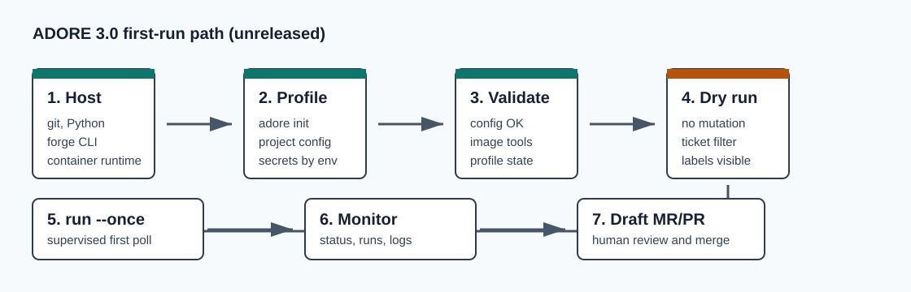

<!--
Copyright (c) 2026 DDP Engineering
This software is licensed under the PolyForm Noncommercial License 1.0.0.
Commercial use requires a separate commercial license.
See the LICENSE.txt file for full license details. SPDX-License-Identifier: LicenseRef-PolyForm-Noncommercial-1.0.0
-->

# ADORE Operator Cheat Sheets

Applies to the unreleased ADORE 3.0 hard-break implementation; installed
version declarations remain 1.2.0 until CR6 acceptance and the release cut.

Use these short operator sheets when you need the fastest safe path through an
ADORE task. They are derived quick references; the full guides in
`01_Documentation/` are authoritative.

For installation and first-run sequencing, use
[Getting_Started.md](../Getting_Started.md). For normal operation and recovery,
use [Operations_Guide.md](../Operations_Guide.md) and
[Recovery_And_Maintenance.md](../Recovery_And_Maintenance.md). For exact
settings and commands, use [Configuration_Reference.md](../Configuration_Reference.md)
and [CLI_Reference.md](../CLI_Reference.md).



## Which Sheet Do I Need?

| Situation | Open this |
| --- | --- |
| I am installing ADORE or running a new project for the first time. | [Setup_And_First_Run.md](Setup_And_First_Run.md) |
| I need to write or prepare a ticket so ADORE can pick it up. | [Tickets_Readiness_And_Labels.md](Tickets_Readiness_And_Labels.md) |
| I need to understand profiles, active project selection, or executor images. | [Profiles_And_Container_Images.md](Profiles_And_Container_Images.md) |
| I need to see what ADORE is doing or pause/resume normal operation. | [Monitoring_And_Steering.md](Monitoring_And_Steering.md) |
| A run is stuck, failed, needs reset, or left resources behind. | [Failure_Recovery_And_Cleanup.md](Failure_Recovery_And_Cleanup.md) |

## Golden Rules

- Start with `adore --profile <name> config validate`.
- Require `bash .agentic/tools/run.sh --json config validate` to return schema 3
  in the target clone.
- Use `adore --profile <name> run --dry-run` before the first real pickup.
- Use `adore --profile <name> run --once` while validating a new project.
- Let ADORE open draft MR/PRs; humans still review and merge.
- Treat waivers as accepted failures and not-enforced/N/A checks as neutral.
- Do not manually edit ADORE marker lines in ticket comments.
- Keep secrets out of `config.toml`; use environment variables or `.env`.

## Command Form

Windows packaged runtime:

```powershell
.\.venv\Scripts\adore.exe --profile <profile-name> status
```

Linux packaged runtime:

```bash
./.venv/bin/adore --profile <profile-name> status
```

Once a profile is active, `--profile <profile-name>` can be omitted.
