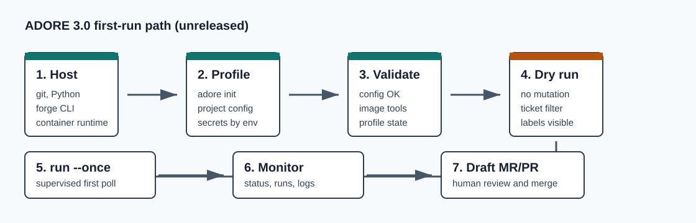

<!--
Copyright (c) 2026 DDP Engineering
This software is licensed under the PolyForm Noncommercial License 1.0.0.
Commercial use requires a separate commercial license.
See the LICENSE.txt file for full license details. SPDX-License-Identifier: LicenseRef-PolyForm-Noncommercial-1.0.0
-->

# Setup And First Run

Applies to released ADORE 3.0.0 and its AEGIS 3.x hard-break contract.

Use this when you are preparing a host, creating a runtime-project profile, or
validating the first safe ADORE poll. The full, authoritative sequence is in
[Getting_Started.md](../Getting_Started.md).



## Operator Goal

End this flow with one validated profile, one dry run, and one supervised poll.
Do not install a background runner until those three checks are clean.

## Before ADORE

Confirm these are available to the same user account that will run ADORE:

- Git.
- Python 3.11 or newer.
- `uv`.
- A container runtime: Docker or Podman.
- A forge CLI: `glab` for GitLab, `gh` for GitHub, or `tea` (>= 0.15) for
  Gitea.
- A local clone of the runtime project.
- An approved WAEGIS 3.0.0 installation and a committed AEGIS 3.0.0 payload in
  that clone.
- Executor credentials supplied through the ADORE runtime environment or its
  `.env` file.
- A project image with the runtime project's tools.

Quick checks:

```powershell
git --version
python --version
glab auth status
docker version
```

```bash
git --version
python3 --version
gh auth status
docker version
```

For Gitea the auth check is `tea whoami` (tea has no `auth status`).

## First Setup Pass

Create or refresh the locked Python environment from the unpacked ADORE runtime:

```powershell
uv sync --frozen
.\.venv\Scripts\adore.exe --version
```

```bash
uv sync --frozen
./.venv/bin/adore --version
```

Expected version:

```text
adore 3.0.0
```

ADORE 3.0.0 is the released hard-break product line for AEGIS 3.x.

Before creating the profile, require the target clone to return `status: ok`
and schema 3:

```bash
bash .agentic/tools/run.sh --json config validate
```

If it does not, preview and approve `waegis adopt <runtime-project>` with the
approved WAEGIS 3.0.0 distribution, then review and commit the payload. WAEGIS
does not branch, stage, commit, or push for you.

## Create The Profile

The wizard writes a runtime-project profile under the ADORE config home. It does
not store secret values, only the names of environment variables that ADORE may
inject into executor containers.

```powershell
.\.venv\Scripts\adore.exe init <profile-name>
```

```bash
./.venv/bin/adore init <profile-name>
```

Choose:

| Wizard area | Recommended first-run answer |
| --- | --- |
| Profile identity | Short lowercase project name. |
| Forge | Match the authenticated CLI: GitLab, GitHub or Gitea. |
| Runtime project | Local clone path plus repo name. |
| State location | Profile-owned state. |
| Container runtime | Docker or Podman command that works from this host. |
| Container image | Runtime-project image, not only the generic base image. |
| Executor | `opencode` unless the project has chosen another implemented executor. |
| Run mode | `once` for validation. |

## Validate Before Pickup

```powershell
.\.venv\Scripts\adore.exe --profile <profile-name> config validate
.\.venv\Scripts\adore.exe profile show <profile-name>
```

```bash
./.venv/bin/adore --profile <profile-name> config validate
./.venv/bin/adore profile show <profile-name>
```

Do not continue until validation prints `OK`.

## Dry Run

Dry run checks ticket visibility and selection without starting delivery work.

```powershell
.\.venv\Scripts\adore.exe --profile <profile-name> run --dry-run
```

```bash
./.venv/bin/adore --profile <profile-name> run --dry-run
```

Look for:

- ADORE can load the profile.
- ADORE can read tickets.
- Control labels such as `agent-hold` and `no-agent` are respected.
- Readiness filters explain why a ticket is or is not eligible.

## Supervised First Poll

Run exactly one real poll while watching the terminal and ticket:

```powershell
.\.venv\Scripts\adore.exe --profile <profile-name> run --once
```

```bash
./.venv/bin/adore --profile <profile-name> run --once
```

Then monitor:

```powershell
.\.venv\Scripts\adore.exe --profile <profile-name> status
.\.venv\Scripts\adore.exe --profile <profile-name> runs
```

```bash
./.venv/bin/adore --profile <profile-name> status
./.venv/bin/adore --profile <profile-name> runs
```

## Safe Completion

After ADORE opens a draft MR/PR:

- Review the draft like any human-authored change.
- Request revisions with the configured revise label, normally `agent-revise`.
- Merge manually only when the human review decision is complete.
- Run `adore cleanup` after closed or merged work if you want a resource sweep.
