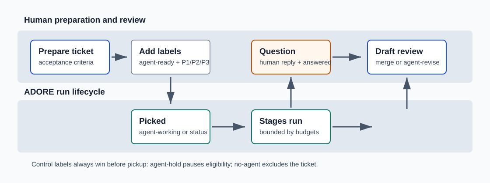

<!--
Copyright (c) 2026 DDP Engineering
This software is licensed under the PolyForm Noncommercial License 1.0.0.
Commercial use requires a separate commercial license.
See the LICENSE.txt file for full license details. SPDX-License-Identifier: LicenseRef-PolyForm-Noncommercial-1.0.0
-->

# Tickets, Readiness, And Labels

Applies to ADORE 0.5.0 and its AEGIS 0.5.x schema-1 hard-break contract.

Use this when you want ADORE to pick up a ticket, skip a ticket, resume a parked
ticket, or route a ticket to a specific executor.



## Ticket Pickup Checklist

A good ADORE ticket has:

- One clear goal.
- Acceptance criteria.
- A small enough scope for the configured `[readiness] max_scope_hint`.
- A known component or folder path when the project requires it.
- One priority label.
- The configured ready label.

Minimal ticket body:

```text
## Goal
Describe the change ADORE should make.

## Acceptance Criteria
- The public behavior changes in this exact way.
- Existing behavior remains unchanged for this case.
- Tests or validation prove the result.

## Scope
Small. Touch only <component/path>.

## Notes
Any constraints, examples, or links the executor must respect.
```

## Human-Managed Labels

Defaults can be renamed in `config.toml`, but the roles stay the same.

| Role | Default label | Who applies it | Effect |
| --- | --- | --- | --- |
| Ready | `agent-ready` | Human | Ticket is eligible for pickup. |
| Answered | `agent-answered` | Human | Parked run may resume after a clarification answer. |
| Hold | `agent-hold` | Human | Prevents new pickup; it does not stop an already-working run. Use `adore cancel` for an active run. |
| Exclude | `no-agent` | Human | Ticket is human-only. |
| Priority high | `P1` | Human | Picked before medium and low. |
| Priority medium | `P2` | Human | Normal priority. |
| Priority low | `P3` | Human | Lower priority. |
| Feature | `feature` | Human | Selects the default full feature run. |
| Bug/fix | `bug` or `fix` | Human | Selects an AEGIS fix run. |
| Change | `change` | Human | Selects an AEGIS change run. |
| Quick | `agent-quick` | Human | Requests the four-stage profile for fix/change only. |
| Executor pin | `agent-exec:<name>` | Human | Forces a configured executor for this ticket. |
| Revise | `agent-revise` | Reviewer | Requests a post-MR revision cycle. |

## ADORE-Managed Lifecycle Labels

These labels are only applied when `[state] channel` is `labels` or `both`.

| Default label | Meaning |
| --- | --- |
| `agent-working` | ADORE claimed the ticket and is running a governed stage. |
| `agent-clarify` | ADORE parked the run and is waiting for a human answer. |
| `agent-mr` | ADORE opened a draft MR/PR and is waiting for review. |
| `agent-failed` | ADORE stopped after a failure, budget, or timeout. |
| `agent-done` | Optional final label after a human merge. |

In comment mode, the authoritative state still lives locally and ADORE mirrors
status through ticket comments instead of lifecycle labels.

## Readiness Rules

The implemented readiness filter rejects tickets that are missing:

- acceptance criteria;
- a priority label;

Known component and scope remain strongly recommended, but
`require_known_component` and `max_scope_hint` are currently validated settings
only and do not filter pickup. Do not treat them as enforcement.

Check the active configuration:

```powershell
.\.venv\Scripts\adore.exe --profile <profile-name> config show
```

```bash
./.venv/bin/adore --profile <profile-name> config show
```

## Common Moves

| What you want | Do this |
| --- | --- |
| Let ADORE pick up a ticket. | Add `agent-ready` plus `P1`, `P2`, or `P3`. |
| Stop pickup temporarily. | Add `agent-hold`. |
| Stop a run already in progress. | Run `adore cancel <run-id>`; a mid-run hold label has no effect. |
| Make the ticket human-only. | Add `no-agent`. |
| Answer a clarification. | Reply in a normal human comment, then add `agent-answered` if labels are used. |
| Request a revision after draft MR/PR review. | Add `agent-revise` to the MR/PR, then run another poll. |
| Force opencode for one ticket. | Add `agent-exec:opencode`. |

Do not remove or edit the hidden ADORE marker lines in status comments.
